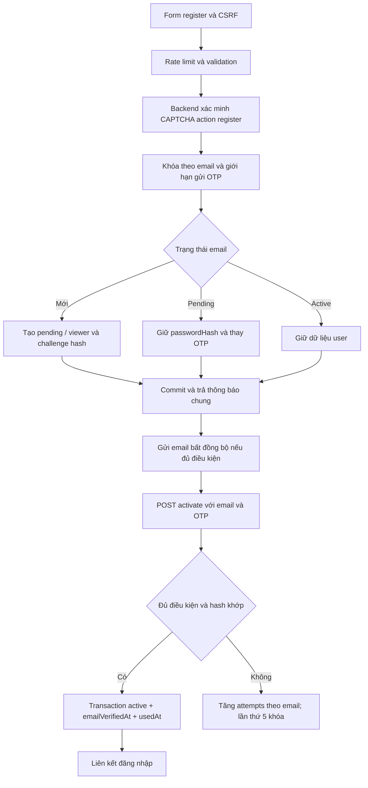

# docRegister — Đăng ký, CAPTCHA và kích hoạt OTP

Cập nhật: 02/11/2026. Mã nguồn: `week6/restaurant`, nhánh làm việc `feat-register`.

Phần đăng ký đã được thay từ liên kết xác minh qua GET sang đăng ký SSR + Google reCAPTCHA v3 + OTP email theo [plan đăng ký](plan/auth-registration-english.md) và [hợp đồng chung](plan/auth-parallel-plan.md). Tài liệu này ghi rõ kết quả tự động đã kiểm chứng và phần provider bên ngoài còn cần cấu hình thật.

Theo xác nhận của nhóm, implementation hiện dùng **SQLite**, tiếp nối schema `week5/api/prisma/schema.sqlite.prisma`. Các mô tả PostgreSQL/row lock trong plan ban đầu được thay bằng transaction và khóa ghi SQLite. Không cần Supabase hay PostgreSQL để chạy phần đăng ký.

## 1. Phạm vi và luồng sử dụng

1. Mở `/register`, nhập email, mật khẩu và xác nhận mật khẩu.
2. Trình duyệt lấy token CAPTCHA mới với action `register` khi submit.
3. Backend kiểm tra request limit, CSRF, dữ liệu, CAPTCHA, khóa OTP và hạn mức gửi thư. User mới được tạo `pending`, `viewer`; password và OTP được hash.
4. Trang kết quả hiển thị thông báo chung và form OTP. Sau khi transaction commit và response hoàn tất, server gửi thư bất đồng bộ.
5. Nhập email + OTP tại `/activate`. Khi mã hợp lệ, server cập nhật `active`, `emailVerifiedAt`, `usedAt` trong một transaction.
6. Chọn liên kết `/login` và đăng nhập bằng mật khẩu ban đầu. Kích hoạt không tự đăng nhập.



Đây là sơ đồ giải thích implementation. Nếu dùng làm bài nộp theo yêu cầu slide, nhóm cần tự xem lại và trình bày sơ đồ bằng hiểu biết của mình.

## 2. Route và phản hồi

| Route | Hành vi |
| --- | --- |
| `GET /register` | Form email/password/confirmPassword, CSRF, CAPTCHA action `register` |
| `POST /register` | Email mới/pending/active cùng 200 và thông báo chung; input sai: 200 `VALIDATION_FAILED` |
| `GET /activate` | Form email/OTP và form gửi lại riêng; GET không kích hoạt tài khoản |
| `POST /activate` | Mã đúng: 200 với link login; sai/hết hạn/đã dùng/sai purpose/unknown: 200 `INVALID_OTP` |
| `POST /activate/resend` | Phản hồi chung 200; chỉ pending nhận OTP mới |
| Các POST auth trên | CSRF/Origin sai: 403; quá hạn mức/đang khóa: 429 `RATE_LIMITED` và `Retry-After`; lỗi kỹ thuật: 500 |

Các mã lỗi được đưa qua view-model `error.code` và HTML EJS (`data-error-code`), không tạo JSON API. CAPTCHA không hợp lệ dùng 200 `CAPTCHA_INVALID`; provider lỗi/cấu hình thiếu dùng 500 `CAPTCHA_PROVIDER_ERROR`.

Form mới dùng root URL. Router giữ alias `/auth/register`, `/auth/activate`, `/auth/activate/resend` cho bookmark cũ. GET `/auth/verify-email` cũ trả 404 và không xác minh email.

## 3. Quy tắc dữ liệu và bảo mật

### Email và mật khẩu

- Email trim khoảng trắng ngoài, lowercase domain, giữ nguyên local-part, dấu chấm và plus tag. Ví dụ ` User.Name+Tag@Example.COM ` thành `User.Name+Tag@example.com`.
- `User.Name@example.com` và `user.name@example.com` là hai khóa khác nhau theo chính sách plan. Không tự áp dụng alias của Gmail.
- Lưu `emailOriginal` sau trim để gửi thư và `email` chuẩn hóa unique để tra cứu. Dùng `validator@13.15.23` kiểm tra định dạng, tối đa 254 ký tự, local-part ASCII.
- Register/login/activate/resend/forgot dùng cùng helper chuẩn hóa. Dữ liệu cũ đã bị lowercase toàn bộ bởi implementation trước không thể khôi phục nguyên bản; script migration giữ email đang lưu làm `emailOriginal`.
- Password đăng ký dài 8–128 ký tự Unicode, confirmation trùng hoàn toàn. Không trim hoặc đổi nội dung password; không render lại password.
- Password mới và OTP dùng `argon2@0.44.0`, Argon2id v19, memoryCost 65536 KiB, timeCost 3, parallelism 1, hashLength 32, salt ngẫu nhiên do thư viện sinh.
- Login vẫn xác minh được hash scrypt của tài khoản cũ; các lần ghi password mới qua helper dùng Argon2id.

### Tài khoản, CAPTCHA, OTP

- User mới luôn có `role=viewer`, `status=pending`, `emailVerifiedAt=null`; không lấy role/status/verified từ body.
- Đăng ký lại pending giữ nguyên `passwordHash` ban đầu, không tạo user thứ hai, đi qua cùng hạn mức gửi mã với resend. Active không bị đổi password/status.
- CAPTCHA dùng adapter v3 với site key/secret v3. Không dùng key v2 hoặc credential Google Cloud với adapter này. Cấu hình adapter khác `v3` bị từ chối.
- Backend kiểm tra `success`, hostname từ `APP_BASE_URL`, action cố định từ route, score tối thiểu 0.5 và tuổi token tối đa 120 giây. Google quyết định token đã dùng; test mô phỏng lỗi `timeout-or-duplicate`. Provider lỗi thì fail closed.
- OTP dùng `crypto.randomInt`, 6 chữ số, purpose `activation`, hạn 10 phút, dùng một lần. Resend tránh sinh trùng ngay mã trước; OTP cũ mất hiệu lực khi challenge mới commit.
- Không persist OTP gốc, không đưa OTP vào response, hidden field, URL hoặc log. OTP thô chỉ nằm tạm trong tác vụ gửi email.
- Một mã chỉ kích hoạt được khi user pending, purpose đúng, còn hạn, chưa dùng, chưa khóa và hash khớp.
- Pending không nhận authenticated session; `/dishes`, `/dishes/:id`, toàn `/admin` chặn trước query CRUD bằng 303 `/login`. Static assets vẫn công khai.
- Form auth dùng session CSRF ẩn danh SQLite, `userId=null`, hạn 30 phút. Cookie `soucha_csrf` chứa định danh ngẫu nhiên; DB lưu `tokenHash`, token CSRF riêng trong session. Cookie HttpOnly, SameSite=Lax, Path=/, host-only, Secure trên HTTPS/production. Auth cookie hiện có tên `soucha_session`.
- Tất cả POST đăng ký/activate/resend kiểm tra CSRF và Origin/Referer khi có. Trang auth trả `Cache-Control: no-store`.

### Ngưỡng mặc định

| Phạm vi | Giới hạn |
| --- | --- |
| Register | 5 request/15 phút/email; 20/15 phút/IP |
| Activate | 10 request/phút/email; 30/phút/IP |
| Gửi mã qua register/resend | Chung 5 request/giờ/email; 20/15 phút/IP; cooldown 60 giây/email |
| Sai OTP | Lần sai thứ 5 khóa 15 phút và trả 429 |

Counter/khóa lưu SQLite, không nằm trong cookie hoặc bộ nhớ tiến trình. Email được SHA-256 làm khóa counter. IP lấy từ kết nối Express với cấu hình proxy mặc định, không tin `X-Forwarded-For` tự gửi. Xóa cookie, thay tab hoặc mở app instance mới không xóa counter.

Hạn mức áp dụng cả pending/active/unknown. Mỗi OTP không hợp lệ tăng `ActivationAttempt`; challenge nếu có được đồng bộ attempts/lockedUntil. Resend và re-register không reset ngân sách; challenge mới kế thừa lịch sử sai của email trước khi tài khoản được tạo. Chỉ hết kỳ khóa mới reset ngân sách.

### Transaction, cạnh tranh và gửi thư

- Register/activate/resend dùng `lockDatabaseWrite()` trước khi đọc dữ liệu trong transaction. Một lệnh UPDATE không đổi dữ liệu giữ quyền ghi SQLite tới commit/rollback, bao phủ cả email chưa tồn tại. Counter vẫn lưu theo email/IP. Không dùng `FOR UPDATE` hoặc advisory lock PostgreSQL.
- SQLite chỉ cho một writer tại một thời điểm; khóa do database quản lý, có hiệu lực giữa các Prisma Client/tiến trình cùng dùng file. Hashing trong transaction giữ khóa lâu hơn; phù hợp phạm vi bài tập, chưa kiểm thử tải lớn.
- Activate đọc lại user/challenge sau khóa, kiểm tra thời gian sau khi chờ khóa và sau verify hash, rồi conditional claim `usedAt` cùng cập nhật User trong một transaction.
- Resend đọc lại pending sau khóa; không ghi đè generation khi activation đã thắng trước.
- Unique-email race với writer khác được rollback/retry một lần. Lỗi ghi challenge rollback cả User mới; lỗi cập nhật user khi kích hoạt rollback cả `usedAt`.
- Response không chờ SMTP. Lỗi gửi thư giữ pending, log `ACTIVATION_MAIL_FAILED` đã che nội dung; người dùng có thể resend sau hạn chờ. Không báo chắc chắn thư đã đến hộp thư.
- Gửi bất đồng bộ trong tiến trình theo lựa chọn plan, chưa có durable queue/retry. Nếu server dừng sau response, thư có thể mất; dùng resend. Các nhánh register cùng chạy hash password/OTP để giảm khác biệt thời gian, nhưng test không chứng minh hết mọi kênh timing trên Internet.

## 4. File triển khai

| File | Vai trò |
| --- | --- |
| `restaurant/src/auth/registration.js` | Các route đăng ký, OTP, resend và transaction |
| `restaurant/src/auth/credentials.js` | Normalize/validate email, Argon2id, CSPRNG, hash/verify OTP |
| `restaurant/src/auth/config.js` | Validate TTL và ngưỡng đăng ký/activation từ env |
| `restaurant/src/auth/throttle.js` | SQLite request bucket, khóa và ngân sách OTP theo email |
| `restaurant/src/auth/database-lock.js` | Giữ quyền ghi SQLite trước các thao tác đọc–sửa–ghi |
| `restaurant/src/auth/captcha.js` | Google reCAPTCHA v3 backend adapter |
| `restaurant/src/auth/mail.js` | SMTP thật và dispatch sau response; giữ hỗ trợ mail reset hiện có |
| `restaurant/src/auth/session.js` | Dùng helper chung, CSRF session ẩn danh, kiểm tra active, tích hợp login |
| `restaurant/src/app.js` | Mount root/alias, bảo vệ CRUD và log lỗi không chứa query arguments |
| `restaurant/prisma/schema.prisma` | UserStatus, bổ sung User/Session và các model activation/counter |
| `restaurant/prisma/registration-upgrade.sql` | Nâng database cũ, backfill emailOriginal/status, giữ password và dữ liệu nhà hàng |
| `restaurant/views/auth/register.ejs`, `activate.ejs` | Form đăng ký, nhập OTP, resend và kết quả |
| `restaurant/public/recaptcha.js`, `views/auth/captcha-script.ejs` | Lấy token mới khi submit form; dùng chung với login |
| `restaurant/tests/auth-registration.test.js` | Test HTTP/unit của feature với DB/provider giả riêng trong test |
| `restaurant/tests/auth-registration.db.js` | Test migration, concurrency, rollback bằng SQLite thật và SMTP cục bộ |
| `restaurant/tests/helpers/sqlite.js`, `legacy-auth.prisma` | File SQLite tạm và schema auth cũ để kiểm thử migration |
| `restaurant/scripts/prisma.js` | Wrapper Prisma CLI đặt log level cho schema engine Windows |

Nhánh có sửa nhỏ login/reset/header/test cũ để dùng email policy, Argon2id, CAPTCHA v3 và session schema chung. Login brute-force theo ngưỡng mới của plan, idle timeout auth, logout và forgot/reset toàn diện là các phần khác; không coi test đăng ký là chứng nhận toàn bộ cụm auth.

## 5. Cài đặt và chạy

Yêu cầu Node.js >=20 và npm. SQLite được Prisma sử dụng trực tiếp qua file, không cần cài server database. Đã kiểm thử trên Windows với Node v24.18.0, Prisma 6.12.0; không cần Docker hoặc credential DB ngoài.

```powershell
cd D:\Minh\Web-design\week6\restaurant
npm.cmd ci
if (!(Test-Path .env)) { Copy-Item .env.example .env }
npm.cmd run db:generate
```

Nếu chưa có `.env`, sao chép `.env.example` rồi điền cấu hình trên máy cá nhân. Giữ nguyên `.env` đã tồn tại, không commit secret.

- `DATABASE_URL="file:./soucha.db"`: đường dẫn tương đối tính từ `prisma/schema.prisma`, tức `week6/restaurant/prisma/soucha.db`. `APP_BASE_URL` và `PORT` cho app.
- `RECAPTCHA_ADAPTER=v3`, `RECAPTCHA_SITE_KEY`, `RECAPTCHA_SECRET_KEY`, `RECAPTCHA_MIN_SCORE=0.5`.
- `SMTP_HOST`, `SMTP_PORT`, `SMTP_SECURE`, `SMTP_FROM`, và `SMTP_USER`/`SMTP_PASS` nếu cần.
- Các biến `ACTIVATION_*`, `REGISTER_*`, `ACTIVATE_*` trong `.env.example` điều chỉnh ngưỡng; duration dùng giây. Giá trị phải là số nguyên dương.

Chọn đúng cách chuẩn bị schema:

- Database mới: chạy `npm.cmd run db:push` để tạo file và đầy đủ bảng.
- Tiếp nối SQLite tuần 5 chỉ có bảng nhà hàng: dừng app đang ghi, sao lưu và sao chép file SQLite thực tế của nhóm vào `week6/restaurant/prisma/soucha.db` khi đường dẫn đích chưa tồn tại. Chạy `npm.cmd run db:push` để bổ sung bảng auth; không chạy `registration-upgrade.sql`. Đã kiểm thử bằng schema tuần 5: món ăn, giá, nguyên liệu, công thức và phân công đầu bếp được giữ nguyên. Test dùng dữ liệu mẫu riêng, chưa kiểm tra file dữ liệu thực của nhóm.
- SQLite đã có `users`/`sessions` theo schema auth cũ, chưa có `emailOriginal`, `role`, `status`: sao lưu rồi chạy `npm.cmd run db:upgrade:register` một lần, sau đó `npm.cmd run db:push`. Script SQL backfill active từ `emailVerifiedAt`, giữ password, xây lại bảng sessions để cho phép `userId=null`, giữ token/CSRF/session cũ và các index/khóa ngoại. Không chạy lại script hoặc áp dụng cho schema khác. Database đã có schema đăng ký hiện tại không cần script nâng cấp.

`db:push` và `db:upgrade:register` chạy qua wrapper đặt `RUST_LOG=info`, giống cách test tuần 5, để tránh thông báo `Schema engine error` trống khi tạo file SQLite mới trên Windows. Không thêm `--accept-data-loss` hoặc reset database. File `.db`, journal/WAL và `.env` được Git bỏ qua.

Không dùng `db:seed` để nâng auth vì seed nhà hàng có thể xóa dữ liệu. Trong phiên triển khai này chỉ áp schema vào SQLite tạm của test; chưa áp migration lên DB của người dùng.

```powershell
npm.cmd start
```

Mở `http://localhost:3001/register`. Hostname trình duyệt phải khớp key reCAPTCHA và `APP_BASE_URL`; HTTPS bắt buộc khi production.

## 6. Tự kiểm thử và đối chiếu yêu cầu

```powershell
npm.cmd test
npm.cmd run test:register
npm.cmd run test:register:db
```

`test:register:db` tự tạo thư mục tạm `soucha-register-*` chứa file SQLite, áp schema, chạy test rồi đóng kết nối và xóa thư mục. Nó ghi đè `DATABASE_URL` trong môi trường tiến trình test bằng đường dẫn tạm, không dùng database của nhóm. Hai Prisma Client độc lập kiểm chứng cạnh tranh OTP và chờ khóa; SMTP chỉ chạy trên loopback. Không còn dependency `embedded-postgres`.

Kết quả thực chạy ngày 02/11/2026:

| Lệnh/nhóm | Kết quả |
| --- | --- |
| Sau triển khai, `npm.cmd test` | 39/39 pass, 0 fail, 0 skipped; gồm 18 test đăng ký |
| `npm.cmd run test:register:db` | 11/11 pass theo Node test runner: 10 kịch bản con + test cha; 0 fail, 0 skipped |
| `npm.cmd run db:generate` | Generate Prisma Client 6.12.0 thành công |
| Prisma `validate` | Schema hợp lệ; dùng URL placeholder, không kết nối DB người dùng |
| `git diff --check` | Không có lỗi whitespace |

10 kịch bản DB/SMTP bao gồm nâng schema tuần 5 và tìm kiếm món sau đăng nhập, migration auth cũ, vòng đời pending → active → login, đăng ký đồng thời, OTP đúng/sai đồng thời, activate/resend race, khóa tồn tại qua nhiều app instance, rollback khi ghi user lỗi, mã hết hạn khi chờ khóa ghi và transport SMTP; các kiểm tra liên quan được gộp trong từng kịch bản. File SQLite tạm được dọn sau test.

Đã cập nhật dependency transitive `body-parser`/`qs` trong phiên bản tương thích và dùng `smtp-server@3.21.3` cho test. Đã gỡ `embedded-postgres` cùng dependency chỉ phục vụ PostgreSQL; không nâng major EJS trong phần đăng ký này. Kết quả chức năng ở trên không thay thế một lần audit dependency trực tuyến mới.

| Tiêu chí | Kiểm chứng tự động |
| --- | --- |
| R01 | pending/viewer, bỏ qua role/status/verified giả, unique email, hash và emailOriginal; HTTP + DB |
| R02 | cùng thông báo 200 cho mới/pending/active, giữ passwordHash cũ, validation 200; HTTP + DB |
| R03 | pending login bị từ chối; request CRUD không truy vấn dữ liệu; HTTP + DB |
| R04 | OTP đúng cập nhật active/verifiedAt/usedAt; 2 request chỉ 1 thắng; rollback và chờ khóa; SQLite thật |
| R05 | wrong/expired/used/purpose mismatch/unknown chung INVALID_OTP; pending/active/unknown chung khóa; concurrent failures không mất lượt; HTTP + DB |
| R06 | cooldown, shared register/resend quota, OTP cũ vô hiệu, ngân sách giữ nguyên, resend/activate race, xử lý OTP trùng ngẫu nhiên; HTTP + DB |
| R07 | activate không tạo auth session; OTP không dùng làm password/sid/reset token; original password vẫn đăng nhập được; HTTP + DB |
| R08 | trim/domain-only lowercase, local-part/plus/dots giữ nguyên, cùng helper các route; HTTP/unit |
| C01/C02 | route không tạo User/gửi OTP khi CAPTCHA không đạt; adapter kiểm tra action/hostname/score/age/replay/provider error; test provider giả |
| C07, phần register/resend | email/IP request quotas, shared cooldown, unknown/active parity, không tin spoofed IP; HTTP + DB |

C03–C06 và phần forgot của C07 thuộc feature login/reset; không đánh dấu hoàn tất các mục đó bằng test đăng ký. Test SMTP dùng Nodemailer thật nói chuyện với SMTP server cục bộ, bắt email và dùng OTP trong email để kích hoạt; đây là kiểm chứng transport cục bộ, chưa chứng minh thư đến Gmail/Outlook hay dịch vụ SMTP bên ngoài.

Login truyền action `login` vào adapter CAPTCHA. Activation đọc lại thời gian sau khi giữ khóa ghi và sau verify hash để mã hết hạn trong lúc chờ không được chấp nhận; test DB giữ quyền ghi bằng một kết nối khác rồi vượt TTL, xác nhận `INVALID_OTP` và không ghi `usedAt`. Tìm kiếm món bỏ tùy chọn Prisma `mode: insensitive` không được SQLite hỗ trợ; đã kiểm tra truy vấn `matcha` tìm được `Week5 Matcha` sau đăng nhập.

## 7. Phần live còn cần cấu hình

Môi trường hiện tại không có `.env`, `DATABASE_URL`, SMTP hay reCAPTCHA credential thật. Vì vậy chưa có bằng chứng Google thực, hộp thư bên ngoài, UI/Network/Cookies trên deployment HTTPS, hoặc migration trên database đang dùng. Không có bypass CAPTCHA hoặc SMTP giả trong app chạy thông thường.

Để nghiệm thu provider sau khi cấu hình:

1. Dùng hộp thư kiểm soát được, mở `/register` và submit CAPTCHA token mới.
2. Kiểm tra response 200 chung, user pending/viewer trong DB và email OTP nhận thật. Không chụp mã gốc hoặc password.
3. Nhập OTP, xác nhận user active/verifiedAt và challenge usedAt cùng có giá trị; browser chưa có auth session.
4. Gửi lại OTP cũ để thấy INVALID_OTP, rồi login bằng password ban đầu.
5. Kiểm tra action/hostname/score/replay bằng token Google thật ở số lượng tối thiểu. Dùng adapter test cho chuỗi request chạm ngưỡng khóa, tránh gửi hàng loạt tới provider.
6. Lưu ảnh Network/Application và bản ghi DB đã che email/OTP/password/hash nhạy cảm/sid/CAPTCHA token/key theo checklist. Không dùng pass của mock làm bằng chứng provider.

## 8. Tài liệu kỹ thuật tham chiếu

- [node-argon2 và các tham số](https://github.com/ranisalt/node-argon2/wiki/Options).
- [validator.js — isEmail](https://github.com/validatorjs/validator.js).
- [Google reCAPTCHA v3 — action, score, token khi submit](https://developers.google.com/recaptcha/docs/v3).
- [Helper SQLite dùng trong test](restaurant/tests/helpers/sqlite.js).

Các ngưỡng trong tài liệu là lựa chọn của plan dự án, không phải khẳng định đây là chính sách bắt buộc chung cho mọi hệ thống.
